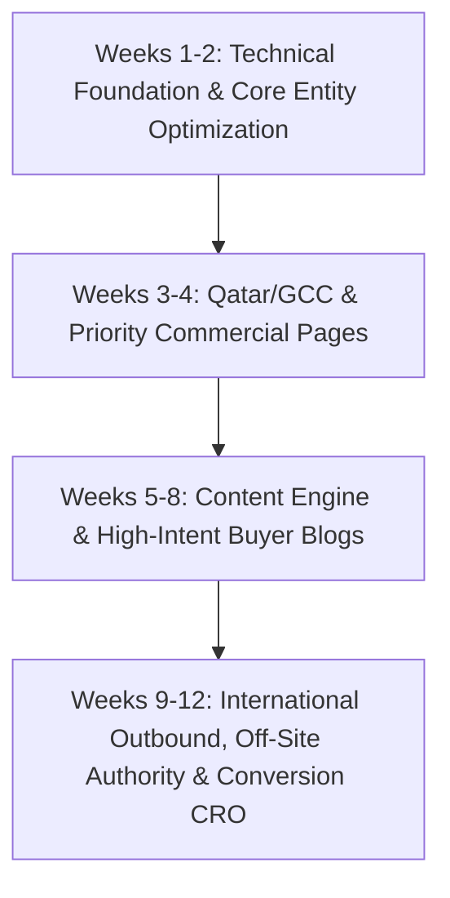

# DevZore 12-Week SEO & Inbound Acquisition Master Plan

**Target Markets:** Qatar & GCC (Primary), UK, USA, Canada, Australia, Pakistan  
**12-Week Goals:** 10,000+ weekly impressions, >2.0% average CTR, 5–10 qualified weekly project inquiries.

---

## 1. Master Keyword-to-Page Mapping (Zero Cannibalization)

Every public indexable page is mapped to exactly ONE primary high-intent commercial keyword:

| Route | Primary Keyword | Search Intent | Target Title (<60 chars) | Target Description (<155 chars) |
| :--- | :--- | :--- | :--- | :--- |
| `/` | `software development company` | Commercial / Branded | Software & Web Development Company \| DevZore | DevZore builds custom business websites, scalable SaaS platforms, mobile apps, and AI solutions worldwide. 100% source code ownership. |
| `/about` | `software engineering agency` | Informational / Trust | About DevZore \| Full-Stack Engineering Agency | Learn about DevZore, a software engineering agency delivering high-performance web applications, SaaS platforms, and operational systems globally. |
| `/contact` | `hire software developers` | Transactional | Contact DevZore \| Request a Software Quote | Contact DevZore to discuss your software project. Request a custom quote for web applications, SaaS products, mobile apps, or enterprise systems. |
| `/allservices` | `software development services` | Commercial Hub | Software Development Services \| Web, Mobile & SaaS | Explore DevZore services: web engineering, mobile apps, generative AI, custom SaaS, cloud deployment, UI/UX, and long-term technical support. |
| `/web-development` | `web application development company` | High-Intent Commercial | Web Application Development Services \| DevZore | Custom web application engineering for businesses worldwide. Fast, responsive, scalable web architectures built with modern frontend and backend tech. |
| `/mern-stack-development` | `mern stack development services` | High-Intent Technical | MERN Stack Development Services \| DevZore | Custom MERN stack engineering with React, Node, Express & MongoDB. Scalable web apps, business dashboards, and custom business portals. |
| `/nextjs-development` | `nextjs development agency` | High-Intent Technical | Next.js Development Agency \| Fast Web Apps | High-performance Next.js development with App Router, SSR, SSG, and sub-second load times. Engineered for maximum SEO visibility and user conversion. |
| `/saas-product-development` | `saas product development services` | Commercial / Founders | Custom SaaS Product Development Services \| DevZore | Turn your software idea into a working SaaS product. Multi-tenant databases, Stripe subscriptions, user permissions, and scalable cloud architectures. |
| `/saas-solutions` | `enterprise saas solutions` | Commercial / B2B | Enterprise SaaS Solutions & Architecture \| DevZore | Scalable SaaS architectures for enterprise businesses and startups. Multi-tenant portals, workflow automation, and cloud-native software modernization. |
| `/ecommerce` | `custom ecommerce development services` | Transactional / Storefront | Custom E-Commerce Development Services \| DevZore | Bespoke online storefronts and e-commerce platforms with fast checkout, secure payments, inventory synchronization, and custom admin portals. |
| `/ecommerce-solutions` | `b2b ecommerce solutions` | B2B / Wholesale | B2B E-Commerce Solutions & Portals \| DevZore | Custom B2B ordering portals, wholesale distribution platforms, multi-vendor marketplaces, and integrated retail commerce solutions. |
| `/mobile-apps` | `mobile app development services` | Commercial | Mobile App Development Services \| iOS & Android | Cross-platform React Native and native mobile applications with modern interfaces, robust API integrations, and reliable backend infrastructure. |
| `/backend-api` | `backend api development services` | Technical B2B | Backend Architecture & REST API Development \| DevZore | High-throughput REST and GraphQL APIs, microservices, and database architecture built with Node.js, Express, MongoDB, and PostgreSQL. |
| `/generative-ai-development` | `generative ai development services` | Modern Commercial | Generative AI Development Services \| LLM Apps | Custom LLM integrations, RAG knowledge bases, AI agents, and workflow automations engineered directly into your production software. |
| `/ai-integration-services` | `ai integration services for business` | Commercial / Modernization | AI Integration Services for Business Software \| DevZore | Upgrade existing web apps and dashboards with Claude, OpenAI, and Gemini APIs. Production RAG pipelines, zero unnecessary rewrites. |
| `/inventory-management-system` | `inventory management software development` | Niche High-Intent B2B | Inventory Management Software Development \| DevZore | Custom stock and warehouse tracking software with multi-location alerts, batch logs, barcode integration, and real-time point-of-sale sync. |
| `/distribution-management-system` | `distribution management system software` | Niche High-Intent B2B | Distribution Management System Software \| DevZore | Route dispatch, delivery tracking, invoice reconciliation, and wholesale distributor ERP software tailored for logistics fleets and warehouses. |
| `/installment-management-software` | `installment software for retail` | Niche High-Intent B2B | Installment Management Software \| Retail Credit ERP | Tamper-proof customer installment tracking, automated penalty calculation, payment schedules, and cashier shift reconciliation for retailers. |
| `/tour-booking-system` | `tour booking system software` | Niche High-Intent GCC | Tour Booking System & Reservation Software \| DevZore | Custom tourism booking engines with real-time slot calendars, WhatsApp voucher dispatch, multi-currency payments, and fleet driver assignment. |
| `/food-ordering-system` | `food ordering system for restaurants` | Niche Commercial | Custom Online Food Ordering System \| DevZore | Commission-free direct digital ordering platform for restaurants with interactive visual menus, modifier add-ons, and instant kitchen queues. |
| `/cloud-deployment` | `cloud deployment and devops services` | Technical B2B | Cloud Deployment & DevOps Services \| DevZore | AWS, Vercel, and Cloudflare cloud infrastructure setup with CI/CD pipelines, Docker containerization, and 99.9% uptime monitoring. |
| `/ui-ux-design` | `ui ux design services for web applications` | Commercial | UI/UX Design Services for Web & Mobile \| DevZore | Interface design and user experience engineering for SaaS dashboards, mobile apps, and business websites. Wireframes, design systems, and Figma handoff. |
| `/seo-services` | `technical seo services for web applications` | Commercial | Technical SEO Services for Web Applications \| DevZore | Server-side prerendering, Core Web Vitals optimization, structured data schema, and crawl architecture for React, Next.js, and SaaS platforms. |
| `/digital-marketing` | `digital marketing services for software` | Commercial | Digital Marketing & Growth for Businesses \| DevZore | Search engine optimization, conversion rate optimization, and high-intent acquisition campaigns for tech companies and commercial websites. |
| `/qatar-software-development` | `software development company qatar` | Regional Priority (GCC) | Software Development Company in Qatar \| DevZore | Custom web platforms, SaaS products, and booking systems for businesses in Qatar and the GCC. Local client experience, English/Arabic ready. |

---

## 2. 12 Buyer-Focused High-Intent Blog Topics

These articles are engineered to target commercial and informational queries typed by founders, CTOs, and business owners ready to invest in software development:

1. **How Much Does a Website Cost in 2026? Complete Pricing Guide**  
   - *Target Query:* `how much does a website cost in 2026`, `website development cost`  
   - *Intent:* Commercial budgeting  
   - *Cross-Links:* `/web-development`, Case Study: `/projects/weldon-paints`
2. **How to Hire a Software Development Company: 9 Critical Questions**  
   - *Target Query:* `how to hire a software development company`, `hiring software agency checklist`  
   - *Intent:* Vendor evaluation  
   - *Cross-Links:* `/contact`, `/allservices`, `/our-process`
3. **MERN Stack vs Next.js: Which Architecture is Right for Your Web Product?**  
   - *Target Query:* `mern stack vs nextjs`, `when to use nextjs vs mern`  
   - *Intent:* Technical evaluation / CTO decision  
   - *Cross-Links:* `/mern-stack-development`, `/nextjs-development`, Case Study: `/projects/frostyops`
4. **Custom Inventory & POS Software vs Off-the-Shelf Tools: Business ROI Guide**  
   - *Target Query:* `custom inventory software vs off the shelf`, `pos software development cost`  
   - *Intent:* Operational decision-making  
   - *Cross-Links:* `/inventory-management-system`, Case Study: `/projects/weldon-paints`
5. **How to Build an Installment & Customer Credit Management System for Retailers**  
   - *Target Query:* `installment software development`, `retail credit management software`  
   - *Intent:* Problem-solving for consumer finance / retail  
   - *Cross-Links:* `/installment-management-software`, Case Study: `/projects/installment-management`
6. **Tour & Safari Booking System Architecture: Real-Time Slots, WhatsApp & Payments**  
   - *Target Query:* `tour booking system software development`, `travel booking platform architecture`  
   - *Intent:* Gulf & international tourism operators  
   - *Cross-Links:* `/tour-booking-system`, `/qatar-software-development`, Case Studies: `/projects/desert-safari-qatar`, `/projects/gulf-dunes-tourism`
7. **SaaS MVP Development Guide: How Founders Launch in 8 to 12 Weeks**  
   - *Target Query:* `saas mvp development guide`, `how to build a saas mvp`  
   - *Intent:* Startup founders / entrepreneurs  
   - *Cross-Links:* `/saas-product-development`, `/startup-mvp`
8. **Multi-Tenant vs Single-Tenant SaaS Architecture: Trade-offs & Security**  
   - *Target Query:* `multi tenant vs single tenant saas architecture`  
   - *Intent:* Senior technical evaluation  
   - *Cross-Links:* `/saas-solutions`, `/backend-api`
9. **How to Integrate AI & LLMs into an Existing Web Application Without Rewriting**  
   - *Target Query:* `integrate ai into web application`, `add chatgpt api to existing app`  
   - *Intent:* Modernization of legacy business software  
   - *Cross-Links:* `/ai-integration-services`, `/generative-ai-development`
10. **Custom Food Ordering System vs Aggregators: Saving 25% on Commissions**  
    - *Target Query:* `custom food ordering system cost`, `restaurant direct ordering platform`  
    - *Intent:* Restaurant chains and food brand owners  
    - *Cross-Links:* `/food-ordering-system`, Case Study: `/projects/sarab-express`
11. **Distribution Management ERP: Solving Fleet Tracking, Invoicing, and Stock Loss**  
    - *Target Query:* `distribution erp software`, `wholesale distribution management system`  
    - *Intent:* Logistics and FMCG wholesale directors  
    - *Cross-Links:* `/distribution-management-system`, Case Study: `/projects/frostyops`
12. **Why Source Code Ownership Matters When Contracting a Software Agency**  
    - *Target Query:* `software development IP ownership`, `vendor lock in custom software`  
    - *Intent:* Risk mitigation for business founders  
    - *Cross-Links:* `/about`, `/contact`, `/allservices`

---

## 3. 12-Week Strategic Implementation & Growth Roadmap

### Phase 1: Weeks 1–2 — Foundation & Conversion Instrumentation
- **Week 1:**
  - Audit and fix title tags, meta descriptions, canonical URLs, and schema markup.
  - Implement universal International Project Brief form across all service and case-study pages.
  - Wire up Google Analytics 4 (GA4) custom events: `form_submit_lead`, `whatsapp_click`, `case_study_view`.
  - Ensure `/thank-you` page has `noindex, follow` and fires the primary lead conversion event.
- **Week 2:**
  - Audit and clean all factual claims (`[NEEDS VERIFICATION]` removed or substantiated).
  - Standardize business contact data across site: phone `+92 334 8004300`, placeholder email `hello@devzore.com`.
  - Fix any 404/301 redirects in `vercel.json` and verify pre-rendering on all 67+ routes.

### Phase 2: Weeks 3–4 — Qatar/GCC Regional Dominance & High-Intent Rebuilds
- **Week 3:**
  - Launch dedicated `/qatar-software-development` landing page highlighting Desert Safari Qatar and Gulf Dunes Tourism case studies.
  - Differentiate overlapping pages (`ecommerce` vs `ecommerce-solutions`, `saas-product-development` vs `saas-solutions`).
- **Week 4:**
  - Enhance case studies (`weldon-paints`, `sarab-express`, `desert-safari-qatar`, `frostyops`) with structured Problem-Solution-Outcome cards, architecture diagrams, and direct service cross-linking.

### Phase 3: Weeks 5–8 — Authority Content Engine & Buyer Guides
- **Week 5–6:**
  - Publish Buyer Guides 1, 2, 3: Website Cost Guide (2026), Software Agency Hiring Checklist, MERN vs Next.js.
  - Internal contextual linking from high-traffic pages to these guides.
- **Week 7–8:**
  - Publish Buyer Guides 4, 5, 6: Inventory/POS Guide, Installment Software Architecture, Tour Booking System Guide.
  - Submit updated sitemap to Google Search Console and trigger IndexNow API.

### Phase 4: Weeks 9–12 — Off-Site Authority, International Reach & CRO Tuning
- **Week 9–10:**
  - Execute Off-Site Checklist: Google Business Profile optimization, Clutch and GoodFirms agency profile setups, LinkedIn Company page showcase.
  - Collect first verified written client reviews and activate `testimonials.js`.
- **Week 11–12:**
  - Review Search Console search queries with impressions >100 and position 11–25.
  - Perform title and CTR micro-experiments on pages near Page 1 threshold.
  - Review WhatsApp conversation quality and optimize form fields based on real client feedback.
